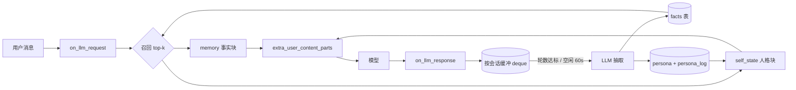
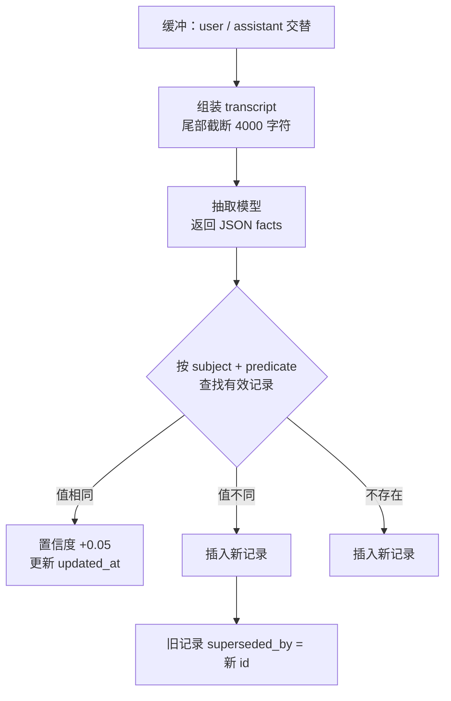
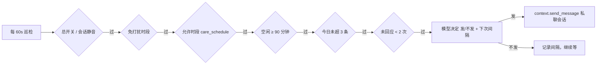

# 记忆与人格演化 · memory_evo

> 一个不做向量库、不接云服务、只记「值得记的」的 AstrBot 长期记忆插件。
> 面向**私聊陪伴**：记住这个人的偏好与约定，同时让性格在几十次对话里缓慢漂移。


[](https://github.com/1244p/astrbot_plugin_memory_evo/actions/workflows/tests.yml)

**一句话**：把聊天压成结构化事实存进 SQLite，每轮按相关度取几条注入；把性格拆成五个连续维度，每次演化限速、并且持续向基线回归。

---

## 为什么还要再造一个

AstrBot 已经有两套记忆相关的能力，但它们各自差一块：

| 现有能力 | 能做什么 | 差在哪 |
|---|---|---|
| 上下文压缩（`llm_compress`） | 长对话不被窗口截断 | 摘要是有损的，用户的偏好会被压成「聊过一些饮食话题」 |
| 知识库（RAG） | 手册、FAQ 这类稳态文档 | 不管「这个人是谁」，没有 per-user 概念 |
| 市场记忆插件 | 多是「把最近 N 条塞进 prompt」或外接云服务 | token 爆炸、数据出境，或根本不改人格 |
| 市场人格插件 | 拟人化状态、好感度 | 只变语气不记事实，和记忆插件叠加会互相污染上下文 |

这个插件只补那两块缺口：**关于人的事实** + **会缓慢变化的性格**。其余的交还给框架。

---

## 特性

- **零依赖**：标准库 + SQLite（WAL），没有向量库、没有外部服务；语义召回借用 AstrBot 已有的 embedding provider
- **语义召回**：配了 embedding 就用余弦相似度，「闻着就反胃」也能命中「不吃香菜」；没配 / 失败自动退回字面匹配
- **事实级记忆**：谓词按槽位归一（饮食偏好 / 忌口 / 口味 → `饮食`），同槽位只留一条有效值；改主意时旧值保留为历史
- **置信度门控**：置信度低于阈值（默认 0.45）且不重要的抽取结果只入库、不注入，抽错不会立刻当真
- **矛盾检测**：「爱吃香菜」遇上「不吃香菜」→ 两条都标记待确认，默认都不注入，等 `/memory confirm` 裁决
- **分类半衰期**：偏好 30 天、画像 60 天、事件 7 天、任务 1 天，过期类记忆自然退场
- **注入多样性**：同一槽位最多 2 条、单条最多 80 字，避免一类记忆吃光预算
- **预算硬约束**：注入前按字符预算截断，默认 600 字符（≈400 token），不会挤爆上下文
- **不破坏提示词缓存**：动态内容走 `extra_user_content_parts`，`system_prompt` 保持稳定
- **按人记忆**：私聊里 `unified_msg_origin` 就是「平台 + 用户」，所以 `/new` 换对话不会失忆；换平台（QQ → WebChat）才算另一个人
- **人格限速演化**：单次变化 ≤ 6%，每轮向基线回归 1%，永远落在 `[0,1]`
- **可观测、可撤销**：`/memory dump|why|forget|persona`，每次演化都有理由和版本号
- **模型可用工具**：`memory_search` / `memory_write` / `memory_forget`，需要时自己查
- **主动开口**：用户安静够久时，它会结合「记得的事 + 当前心情」自己发一条，而不是定时刷屏
- **WebUI 面板**：记忆 / 人格 / 主动消息 / 设置四个页签，可搜可筛、可批量删可确认、可导出，配置项直接在面板里改（v0.5 → v0.6）
- **离线可跑测试**：127 个用例不需要安装 AstrBot 也能执行

---

## 工作原理

### 总览



两条独立的链路：**读链路每轮都跑，写链路由节流触发**。写永远不阻塞回复。

### 一、写：把对话压成事实



三个刻意的设计：

1. **抽取而不是存档**。原文太长、噪声太多，而且「用户说过 300 句话」本身不可检索。抽成 `{subject, predicate, object}` 之后，一条记忆就是一个可打分、可比较、可覆盖的单元。
2. **superseded 而不是 delete**。用户说「我搬去杭州了」不该抹掉「之前住上海」——历史留着，当前值只有一条。`/memory` 只显示有效记录，`history_of()` 能看到完整变迁。
3. **写操作异步**。抽取要额外调一次 LLM，放在回复链路里会拖慢首 token。所以先缓冲，等轮数达标或空闲 60 秒再批量处理；失败只记日志，不影响本轮回复。

### 二、读：打分 + 预算

召回不用向量，用四个信号线性组合：

```
# 有向量（配了 embedding provider）
score = 0.50 × 余弦相似度
      + 0.20 × 新近度       # 0.5 ^ (天数 / 半衰期)，半衰期按类型分档
      + 0.20 × 重要度       # importance / 5
      + 0.10 × 置信度

# 没有向量（未配置 / 调用失败 / 维度或模型不匹配）
score = 0.50 × 字面相关     # CJK 单字+双字、拉丁按词的重叠率
      + 同样的三项

半衰期：preference 30d / profile 60d / fact 14d / event 7d / task 1d
门控：confidence < 0.45 且 importance < 5 → 不注入
多样性：同一槽位 ≤ 2 条，单条 ≤ 80 字
```

两条路共用同一套权重，所以「换召回方式」不会让行为突变。向量在写入时算一次、L2 归一化后以 float32 存进 `facts.embedding`；查询时把 query 也归一化，点积即余弦。历史数据靠后台每 20 秒补一批（`/memory reindex` 可手动触发），补不上就一直走字面，不会阻塞回复。

按分数降序取，边取边累加字符数，超预算就跳过继续找下一条（而不是直接截断，避免大条目吃光预算）。

**矛盾怎么办。** 谓词先归一到槽位（`饮食偏好`、`忌口`、`口味` 都是 `饮食`），再比对新旧值的极性：「爱吃香菜」正向、「不吃香菜」反向，核心词重叠 → 两条都标 `suspect`，默认不参与注入，只在 `/memory dump` 和 `memory_search` 里以「⚠️待确认」出现，等 `/memory confirm <id>` 裁决。这样模型抽错一句，不会立刻污染人格判断。

注入位置是这个插件唯一「有主见」的地方：

```python
req.extra_user_content_parts.append(TextPart(text="<memory>…</memory>"))
```

而不是 `req.system_prompt += "…"`。原因很实在：system_prompt 每轮都变，模型服务端的提示词缓存就失效，成本和首 token 延迟一起涨。而 `extra_user_content_parts` 落在本轮用户消息之后，既不会因为上下文压缩被丢掉（压缩只从最旧的整轮开始丢，最后一轮永远保留），也不会污染缓存前缀。

### 三、人格：为什么要限速

性格不是数值越大越好，而是**不能突变、也不能漂到极值**。所以三层约束叠在一起：

```python
# 1. 步长截断：一次对话最多变 6%
delta = clamp(delta, -max_step, +max_step)

# 2. 基线回归：每轮向出厂性格拉回 decay
value += (baseline - value) * decay

# 3. 硬边界
value = clamp(value, 0.0, 1.0)
```

五个维度：**亲密度 / 跳脱度 / 直给度 / 主动度 / 温度**。

- 只有 `delta`，没有绝对值——模型没法一把把性格设成 1.0
- `decay` 让角色有「性格底色」：吵完架会降温，但不会永久变成另一个人
- 每次演化写入 `persona_log`（traits + 理由 + 版本号），`/memory persona` 可查、可回滚

渲染时不暴露数字，只给程度词：

```
<self_state>
当前状态：亲密度偏高、跳脱度中等、直给度中等、主动度偏低、温度偏高。此刻心情：放松。
自然地体现在语气和取舍里，不要直白复述这些设定。
</self_state>
```

最后那句「不要直白复述」是必须的，否则模型会开始念设定。

### 数据模型

```sql
facts(id, scope, subject, predicate, object, kind, importance,
      confidence, evidence, created_at, updated_at,
      superseded_by, last_hit_at, hits,
      polarity, status, conflict_with,
      embedding, embedding_model)

persona(scope PK, traits JSON, mood, version, updated_at)

persona_log(id, scope, traits JSON, reason, created_at)
```

`scope` 就是 `unified_msg_origin`（`platform:type:session_id`），天然完成隔离，不需要额外租户逻辑。

---

> 更新记录见 [CHANGELOG.md](CHANGELOG.md)。

## 安装

**方式一：WebUI**

插件 → 安装插件 → 填仓库地址 → 确认。

**方式二：手动**

```bash
cd <AstrBot>/data/plugins
git clone https://github.com/1244p/astrbot_plugin_memory_evo.git
# 重启 AstrBot，或在 WebUI 里「重载插件」
```

装完私聊发 `/memory` 看命令是否生效。

数据落在 `data/plugin_data/astrbot_plugin_memory_evo/memory.db`，单文件，删掉即重置。

---

## 配置

两处改，写的是同一份配置：Dashboard 插件页的**「设置」页签**（推荐，带说明和边界校验，保存即生效），或直接改插件配置文件。下表是完整清单。

| 键 | 默认 | 说明 |
|---|---|---|
| `enable` | `true` | 总开关 |
| `top_k` | `6` | 每轮注入条数，4~8 比较稳 |
| `max_inject_chars` | `600` | 注入字符上限，别超过上下文窗口 10% |
| `semantic_recall` | `true` | 语义召回总开关（无 embedding provider 时自动失效） |
| `embedding_provider_id` | 空 | 留空用第一个可用的 embedding 提供商 |
| `embedding_timeout` | `10` | 单次 embedding 请求超时（秒） |
| `min_confidence` | `0.45` | 低于此值且重要度 <5 的事实只入库不注入 |
| `include_suspect` | `false` | 是否把「待确认」冲突记忆也注入（默认不） |
| `max_per_predicate` | `2` | 同一槽位最多注入几条 |
| `max_item_chars` | `80` | 单条记忆注入最大字符 |
| `persona_inject` | `true` | 注入 `<self_state>` |
| `persona_evolve` | `true` | 允许人格演化 |
| `max_step` | `0.06` | 单次演化最大步长 |
| `decay` | `0.01` | 向基线回归速度 |
| `baseline_*` | `0.5` | 出厂性格（五维各一项） |
| `care_enable` | `false` | 主动消息总开关（仅私聊） |
| `care_min_idle_minutes` | `90` | 至少空闲多少分钟才考虑开口 |
| `care_daily_max` | `3` | 每日主动上限 |
| `care_max_unanswered` | `2` | 连续未回应几次后停止 |
| `care_quiet_start` / `care_quiet_end` | `23:30` / `08:00` | 免打扰窗口，支持跨零点 |
| `care_schedule` | 空 | 允许时段白名单，留空=不限；`09:00-12:00,19:00-23:00`，支持跨零点 |
| `care_probability` | `0.85` | 满足条件后仍按概率决定 |
| `care_max_chars` | `45` | 主动消息长度上限 |
| `care_timezone` | `Asia/Shanghai` | 免打扰与时间判断用的时区 |
| `care_provider_id` | 空 | 生成用 provider，留空复用抽取模型 |
| `flush_turns` | `6` | 多少轮用户消息触发一次抽取 |
| `idle_seconds` | `60` | 空闲多久补写缓冲 |
| `max_buffer` | `40` | 单会话缓冲上限 |
| `extract_provider_id` | 空 | **建议填便宜模型**，留空复用当前会话模型 |
| `llm_timeout` | `45` | 抽取超时，超时跳过不影响回复 |

### 三套现成配方

| 目标 | 配置 |
|---|---|
| 日常陪伴（默认） | `top_k=6, flush_turns=6, max_step=0.05, decay=0.01` |
| 高密度私聊（一天几十轮） | `top_k=8, flush_turns=4, max_inject_chars=800` |
| 想要「半年后判若两人」 | `max_step=0.08, decay=0.002`，`baseline_*` 按角色设定 |

---

## 主动开口（v0.4）

不是定时任务，是**空闲触发 + 多重闸门**：



| 规则 | 默认 | 说明 |
|---|---|---|
| 总开关 | 关 | `care_enable`，只对私聊生效 |
| 最少空闲 | 90 分钟 | 用户刚说完话时绝不会插进来 |
| 免打扰 | 23:30–08:00 | 黑名单，支持跨零点窗口 |
| 允许时段 | `care_schedule` 留空=不限 | 白名单，填了之后只在窗口内发，如 `09:00-12:00,19:00-23:00` |
| 每日上限 | 3 条 | 防止变成骚扰 |
| 连续未回应 | 2 次后停 | 你不理它，它就闭嘴，等你先开口 |
| 触发概率 | 0.85 | 满足条件也可能不发，避免过于规律 |
| 生成长度 | ≤45 字 | 短一点才像真人 |

**两处关键设计**：

1. **模型自己决定下一次何时来**。生成时同时返回 `next_gap_minutes`（15–240），下次巡检至少等这么久，不像固定心跳那样可预测。
2. **内容是长出来的，不是模板**。提示词里带三样东西：人格当前状态、记忆里最相关的 3–4 条事实、上次主动说过的话（防重复）。所以它可能说「在改那个 bug 吗，别熬太晚」，而不是「今天过得怎么样」。

```
/memory care status   # 当前状态、今日已发、未回应计数
/memory care off      # 只静音这个会话
/memory care on       # 恢复
/memory care now      # 立刻试发一条（跳过空闲/冷却/上限，仍守免打扰）
```

**免打扰 vs 允许时段**：一个是黑名单，一个是白名单，冲突时**黑名单优先**。

```
care_quiet_start/end = 23:30/08:00     → 这两个时段绝不说
care_schedule        = 09:00-12:00,19:00-23:00  → 只在这两段说
```

两者都支持跨零点（`22:00-02:00`）；`care_schedule` 留空就是不限时段，行为和 v0.4.0 一致，老配置不用改。一开始发不发由「空闲 + 每日上限 + 未回应」这些闸门管，**时段只是把可发的时间窗再收窄**。

> 对比市场同类（`proactive_chat` 87k 下载、`proactive_care` 的链式唤醒、`private_companion` 的编排），这里的取舍是：**不另建一套状态，直接吃记忆和人格**。好处是零重复配置、说法有据可依；代价是没有独立的编排面板，主动相关的状态都在面板的「主动消息」页签里。

## WebUI 面板（v0.5）

不想敲命令时，在 **Dashboard → 插件 → 记忆与人格演化 → 打开插件页面** 里看同一个库：

| 页签 | 能看到什么 | 能改什么 |
|---|---|---|
| 记忆 | 有效 / 待确认 / 已取代条数、平均置信度、向量覆盖率、从未召回数；按关键词、类型、状态筛选并分页 | 勾选批量删除、批量确认待确认条目、导出该会话 JSON |
| 人格 | 五维当前值（灰色刻度是基线）+ 演化时间线（版本、原因、当时取值） | 只读（改人格只能通过对话，这是故意的） |
| 主动消息 | 本会话开关、今日已发 / 上限、连续未回应、下次最早**时刻**（`HH:MM` + 还要等多久）、卡在哪道闸门、免打扰与允许时段 | 开 / 关这个会话的主动消息 |
| 设置 | 37 个配置项分六组：基础 / 注入与召回 / 人格 / 语义召回 / 主动消息 / 抽取模型，每项带说明与边界 | 全部可改，保存即生效（`db_path` 标「需重启」）；字段不合法会当场标红，整批不落盘 |

几个实现上的取舍：

- **不是另起服务**：用 `context.register_web_api()` 注册 9 个插件内路由，走 Dashboard 的插件转发
  （`/api/v1/plugins/extensions/<plugin>/<subpath>`），不额外监听端口，也没有第二份鉴权。
- **写操作带 `scope`**：删除、确认都只作用于当前选中的会话，拿别的会话 id 过来也改不动（有测试覆盖）。
- **确认只认 suspect**：不会把已取代或已生效的条目顺手改成 active。
- **老框架自动降级**：没有 `register_web_api` 的 AstrBot 直接跳过注册，命令与钩子照常工作；面板本身需要 AstrBot ≥ 4.29。
- **主题跟随**：`bridge.ready()` 返回的 `isDark` / `locale` 直接用，暗色模式不用另配。
- **设置不另存一份**：表单字段由 `_conf_schema.json` 生成，保存时写回框架的插件配置并 `save_config()`；
  校验先全过再落盘，避免存进半套配置。

面板读的是同一个 `memory.db`，所以 `/memory dump` 和面板里看到的内容永远一致——两者只是同一份数据的两个入口。

## 命令

| 命令 | 作用 |
|---|---|
| `/memory` | 帮助 |
| `/memory dump` | 列出当前会话的有效记忆 |
| `/memory why <词>` | 查看召回打分，调 `top_k` 时必备 |
| `/memory confirm <id>` | 确认一条待确认记忆，冲突的另一条自动归档 |
| `/memory reindex` | 手动补写缺失的语义向量 |
| `/memory care [on/off/status/now]` | 主动开口的开关、状态与立即试发 |
| `/memory forget <id\|词\|all>` | 删除记忆 |
| `/memory persona` | 五维当前值 + 最近 5 次演化及理由 |

## 给模型用的工具

| 工具 | 签名 | 何时调用 |
|---|---|---|
| `memory_search` | `(query, k)` | 回答涉及用户偏好、经历、约定时 |
| `memory_write` | `(content, kind, importance)` | 用户明确说「记住」或出现值得长期保留的信息 |
| `memory_forget` | `(fact_id)` | 用户要求删除某条记忆 |

---

## 与框架其他能力的关系

- **上下文压缩**：不冲突。压缩作用于 `req.contexts`，本插件注入的块在本轮消息里，不会被丢。
- **知识库**：互补。知识库放「文档」，本插件放「关于这个人」。
- **`provider_ltm_settings.group_icl_enable`**：可以共存，但注意预算——两者都在加内容，建议总注入控制在窗口 15% 以内。

## 与同类插件对比

| | 本插件 | 纯事实注入类 | 本地向量类 | 云记忆服务 | 拟人人格类 |
|---|---|---|---|---|---|
| 存什么 | 结构化事实 + 五维人格 | 全文 / Markdown | 向量片段 | 云端托管 | 情绪 / 好感度 |
| 依赖 | 无 | 无 | Embedding 模型 + 磁盘 | 外部 API | 无 |
| token 可控性 | 硬预算 | 常全量塞 prompt | 取决于 top-k | 黑盒 | 不涉及 |
| 人格演化 | 有，带限速与回归 | 无 | 少数有 | 少数有 | 有，但无事实记忆 |
| 隐私 | 全本地 | 全本地 | 全本地 | 出境 | 全本地 |

---

## 开发

```bash
# 不需要安装 AstrBot，用 stub 顶掉依赖
python -m unittest discover -s tests -v
```

```
Ran 75 tests — OK
```

覆盖：重复事实合并、改值 supersede、会话隔离、召回排序与预算、遗忘、人格步长/边界/回归、
JSON 容错解析、钩子注入、工具读写、flush 落库；以及 v0.2 的置信度门控、分类半衰期、
矛盾检测与裁决、谓词归一、注入多样性、旧库自动迁移；以及语义召回的 paraphrase 命中、
无向量回退、维度/模型不匹配回退、向量归一化、补写统计。

目录：

```
astrbot_plugin_memory_evo/
├── main.py        # 钩子、工具、命令
├── store.py       # SQLite 事实库与人格状态
├── persona.py     # 五维演化数学（纯函数）
├── extractor.py   # 提示词与容错 JSON 解析
├── _conf_schema.json
├── metadata.yaml
└── tests/
```

## Roadmap

- [x] 置信度门控 + 矛盾检测 + 分类半衰期 + 注入多样性（v0.2.0）
- [x] 语义召回：embedding + 余弦，失败自动回退（v0.3.0）
- [x] 主动开口：空闲触发 + 免打扰 + 每日上限 + 模型决定下次间隔（v0.4.0）
- [x] 主动开口支持允许时段白名单 `care_schedule`（v0.4.1）
- [ ] `task` / `event` 带到期时间，到期主动提一句
- [ ] 跨平台身份归一：`/memory link` 把 QQ / WebChat 的两个 umo 绑成同一个人
- [ ] 事实超过阈值时做同槽位合并摘要
- [x] WebUI 面板：记忆 / 人格 / 主动消息（v0.5.0）
- [x] 面板内改配置：设置页签 + 保存即生效（v0.6.0）
- [ ] `/memory export` 导出 Markdown，便于备份与迁移

## FAQ

**Q：用了 embedding，为什么还是不用向量库？**
单机单人通常只有几百到几千条事实，暴力余弦一遍是毫秒级，FAISS 那套索引、维度管理、重建流程在这个量级纯属负担。等记忆上万条，再考虑换索引——`recall` 内部换实现即可，外部接口不变。

**Q：没配 embedding 会怎样？**
自动退回字面匹配，功能不受影响，只是同义改写会漏。配了之后历史数据会在后台慢慢补向量，`/memory reindex` 可以立刻补。

**Q：记忆会不会越存越乱？**
不会无限增长：同一个 `(主体, 谓词)` 只有一条有效记录，改主意是 supersede 不是堆叠。真要清理，`/memory forget all` 一条命令。

**Q：主动消息会不会刷屏？**
默认关着；开了也有五道闸：最少空闲 90 分钟、每日 ≤3 条、连续 2 次没回应就停、23:30–08:00 不打扰、允许时段白名单。想更保守就把 `care_daily_max` 设成 1、`care_min_idle_minutes` 设成 180、`care_schedule` 填成 `10:00-11:00,21:00-22:00`。

**Q：换平台 / 换号会丢记忆吗？**
会。记忆的 key 是 `platform:message_type:session_id`，私聊里就是「平台 + 用户 ID」。QQ 和 WebChat 聊同一个人，是两份记忆。要打通得做身份归一（见 Roadmap）。

**Q：`/new` 或 `/reset` 会清记忆吗？**
不会。`/new` 只换对话（对话历史），不动 `unified_msg_origin`，所以记忆和人格都还在。真想清空用 `/memory forget all`。

**Q：只做私聊，群聊能用吗？**
能跑，但整个群会被当成一个「人」——群里所有人的偏好会混在一起。这个插件是按私聊陪伴设计的，不建议直接在群里开。

**Q：抽取用主模型会不会很贵？**
会。所以配置里有 `extract_provider_id`，填一个便宜模型；`flush_turns` 调大也能直接降频。

**Q：人格会不会被用户故意带偏？**
有 `max_step` 限速和 `decay` 回归，单次对话最多 6%，且每轮往基线拉回。要更保险就把 `max_step` 降到 0.03。

---

## License

[MIT](LICENSE)

## 致谢

思路来自 AstrBot 社区的多次讨论：记忆该存「事实」而不是「文本」，人格该「漂移」而不是「设定」。
